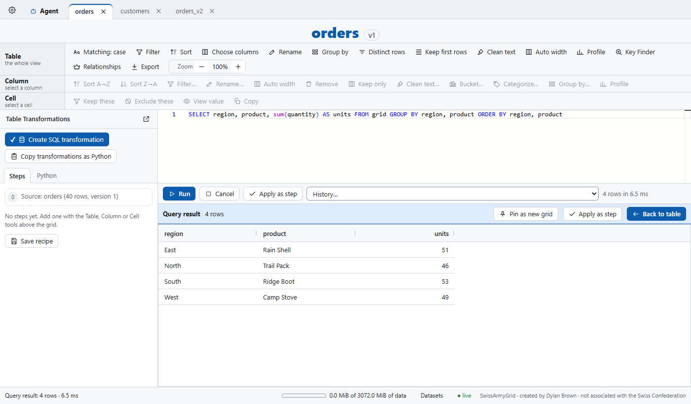
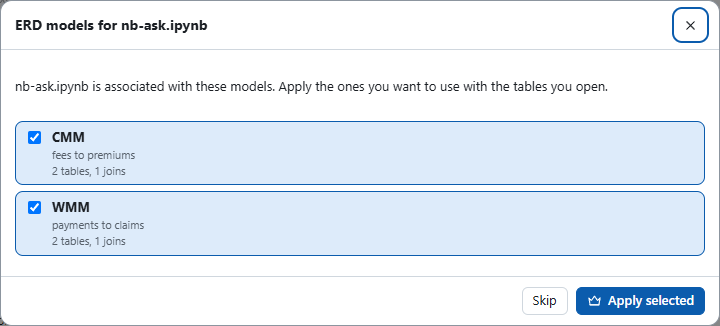

# SwissArmyGrid user guide

SwissArmyGrid is a local data grid that runs on your own machine. You push a pandas DataFrame from Python, and it opens as a tab in a browser page where you can filter, sort, compare and profile the table without changing the source data. Every change you make is a step you can see, turn off or export as Python.

## Getting data in

Set the package up once with the `/finance-toolbox:swissarmygrid-setup` skill. After that, push a DataFrame from any script or notebook:

```python
import swissarmygrid as sag

sag.push(orders)
```

The grid is named after the variable, here `orders`. To choose the name yourself, pass `name=`. Names can be 1 to 64 letters, digits, `_` or `-`.

```python
sag.push(orders, name="orders", new_grid=True)
```

`new_grid=True` opens a new grid even when one with the same name is already open. Without it, pushing again refreshes the same grid, and its steps stay in place.

## The workspace


The page has these parts:

- **Tab bar.** The cog at the far left opens Settings. The Agent tab comes next and cannot be closed. Each open grid has its own tab after it, and the + after the last tab starts a new table from a query (see below).
- **Title.** The dataset name and its version. A new push to the same dataset raises the version.
- **Ribbon.** Three rows, each named for what its buttons act on. **Table** works on the whole view. **Column** works on the selected column or columns. **Cell** works on the selected cells. Buttons that have nothing to act on are greyed out, and the caption under each row name says what it is looking at.
- **Grid.** The rows, with the column headers above them.
- **Table Transformations.** The steps applied to the grid, in order, starting from the source. It is on the right of the grid. Click the arrow at its top right to collapse it to a slim bar and give the grid the room; click the arrow on the bar to open it again. SwissArmyGrid remembers which you chose.
- **Status bar.** The row count, the selection summary and the memory meter.

### Settings

Open Settings with the cog. It holds the settings for this browser (the theme, and whether column headers show their profile), the setup prompt for connecting an agent and the privacy settings described below.


The "Connect an agent" box holds a prompt you can copy into Claude Code or another agent that has a shell. It tells that agent how to add the SwissArmyGrid MCP server.

## Working with a table

### Selecting cells, rows and columns

Selection works the way it does in a spreadsheet.

1. Drag across cells to select a block. The status bar shows the count, and the sum and average when the values are numbers.
2. Click a row number to select the row. Drag down the row numbers to select several rows. Hold Ctrl and click another row number to add it.
3. Click a column header to select the whole column. The Column row then names it in its caption.


Ctrl+A selects everything, and Ctrl+C copies the selection. Click anywhere outside the grid, or press Escape, to clear the selection. The ribbon's buttons, menus and dialogs don't clear it, because they act on it.

Scrolling sideways is free: the view stops wherever you leave it, even in the middle of a column that is wider than the screen.


### Ribbon tools

The Table row holds the tools for the whole view: matching, Filter, Sort, Choose columns, Rename, Group by, Distinct rows, Keep first rows, Clean text, Auto width, Profile, Key Finder, Relationships, Export and the zoom control.

The Column row acts on the selected column. It has Sort A to Z and Z to A, Filter, Rename, Auto width, Remove, Keep only, Clean text, Bucket, Categorize, Group by and Profile. The Cell row keeps or excludes rows with the selected cell's value, shows the full value and copies.

### Filter steps

1. Click Filter in the Table row.
2. Choose a column, a condition and a value, then press Add step.
3. The step appears in Table Transformations with the row count before and after it.


Each step has a checkbox to switch it off, a pencil to edit it and a trash icon to delete it. Turning a step off shows the grid without it, which is the quickest way to check what a step changed.

### SQL steps

Create SQL transformation, at the top of Table Transformations, opens a query box. Write a query that reads the table by its dataset name, the same name the variable has in your Python (`FROM SOD` for a table you pushed as `SOD`), then press Ctrl+Enter or Run. In the query box that name reads the table as it was loaded, the same rows your Python variable holds, so you can paste the query into `duckdb.sql(...)` in your notebook unchanged and get the same answer. `grid` reads the table as it is after its steps. Once you apply the query as a step, either name means the table entering that step. If the table already has steps before it, the step can therefore show different rows from the box. With the SQL step first, the box, the step and your notebook all agree.

1. Click Create SQL transformation in Table Transformations.
2. Type the query. Column names autocomplete.
3. Press Run. The result replaces the grid until you press Back to table.
4. Press Apply as step to keep the query as a step, or Pin as new grid to open the result as its own table.



The query box accepts one SELECT or WITH statement. A query can read this table or any other open dataset by name, so a join works there; pin its result as a new grid to keep it. A query kept with Apply as step reads only the table entering it.

### A new table from a query

The + after the last tab opens a new tab with a query tray over a blank grid. Use it to build a table of your own from the tables you have open, such as a join of two of them.

1. Click + after the last tab. The new tab is named query_1, or the next free number. Type another name in the tray if you want one.
2. Write one SELECT. A table name reads that table as its tab shows it, after its steps, so a filter you added there applies here too. If a table is open in two tabs, its name reads the first one.
3. Press the green Run button, or Ctrl+Enter. The result becomes the table in this tab, with the ribbon, Table Transformations and everything else a pushed table has.

The tray stays at the top of the tab. Change the query and press Run again to rebuild the table in place; the steps you added to it then apply to the new rows. The arrow at the left of the tray folds it down to one row. The table doesn't update by itself when the tables it reads change: press Run again for that.

### Profiles

Click a column header, then Profile in the Column row, to open a popup for that column. It shows the row count, blanks, distinct values, the shortest and longest values, and the most common values. Click a value to add a filter step for it.


Profile in the Table row profiles every column at once, with the type, blank counts, distinct counts and the minimum value of each. Export profile (CSV) saves that table.


### Auto width

Auto width in the Table row fits every column to its header and the rows on screen. The same button in the Column row fits only the selected columns.


### Value viewer

Double-click a cell that holds a long text or a JSON value to open it in the value viewer. A JSON object shows as a table of keys and values, and the JSON tab shows the raw text. Long text shows its length and wraps.


### Export and zoom

Export in the Table row writes the grid as CSV, text, Excel or Parquet. The file is built from the grid's steps, so it matches what you see. Choose a download or the export folder.

The zoom control in the Table row changes the text and row size of the grid. Ctrl+= and Ctrl+- step the zoom, and Ctrl+0 resets it to 100%.

## Comparing two tables

Two grids can sit side by side, and they can be lined up row for row on a key.

1. Drag one grid's tab onto the middle of another grid's tab. The two grids show side by side, and the key picker opens.
2. The picker lists the column pairs that share values, best first. Tick the pair that identifies the same row in both tables. To use a key made of two columns, tick both pairs.
3. If no pair fits, choose the columns in the "Or pick a pair yourself" row and press Add.
4. Press Compare.


The Key Finder runs when the picker opens. It ranks the pairs by the share of values that match on each side. Read the list before you trust the first row. In this sample, order_date ranked above order_id, because its values also match on both sides. Tick the key you mean. When the two tables have a known relationship (see Relationships below), its columns come first with a crown, already ticked.

The Key Finder also runs on its own from the Table row. It opens in a window of its own, titled "Possible Join Keys for" your table, so you can keep it beside the grids. Choose the table to compare with and press Find keys. Each row shows your column, the other table and its column, the relationship it looks like, the share of each table's values found in the other (headed by the table names) and the shared values as fractions. Click a row to see sample values that match and values that do not. Known relationships carry a crown.

Above the pairs, every run also shows the most distinct column combination in your table: the fewest columns that together tell every row apart, which is usually the table's primary key. It reads the first 400,000 rows of the grid as it stands after its steps. The search starts with the column that has the most distinct values, then adds whichever column tells the most remaining rows apart, one at a time. Each of those rows shows the share of rows the combination tells apart. The last row, marked with an accent edge, is the answer. Any other combination just as small that is also unique per row is listed under it. If no combination tells every row apart, the table repeats whole rows, and the answer says how many. The search adds one column at a time, so it finds a small key quickly, but a different key of the same size can exist. Check one you mean with a count in the SQL box.


### Reading the aligned view

Once compared, the two grids always line up. Row N on the left and row N on the right share a key. When a side has no row for a key, a striped blank row sits opposite the row that has it. The two grids scroll together through one scrollbar in the centre.


Cells that differ between the two sides are marked with a coloured bar. Click any row to highlight every row with the same key on both sides, so you can see the same order on the left and the right at once.


### Compare modes

The Compare row in the ribbon switches the mode.

- **Outer join** shows every key from both tables, as above.
- **Anti join** shows only the keys with no match on the other side. Choose both sides, only the left table or only the right table.
- **Cross compare** keeps each grid on its own rows. Click a row on one side to filter the other side to that key.
- **Stop compare** returns to two independent grids. The side-by-side view stays, with no keys.

## The Agent tab

The Agent tab is the first tab. It holds the Analysis Sandbox, one for every table, where charts, notes and diagrams live. Each card names the table it is drawn on.

To add a chart, press Add chart. Choose the table, the chart type, the column for the X axis, the aggregate (such as sum) and the column for the Y axis. To add a note, press Add note, give it a title and write its text in Markdown.


Clicking a bar in a chart filters the grid to that value. Each card has a pin, a zoom button for a larger view, and a remove button.

### How an agent sees the grids

An agent works on your tables through the SwissArmyGrid MCP server, which has one tool for each thing the grid can do (anything you can do with a button, the agent can do with a command, named for the part of the app it belongs to (`table_`, `column_`, `cell_`, `steps_`, `compare_`...), except the controls that are yours alone, such as this privacy level). The plugin provides it, the setup prompt in Settings installs it in other agents, and the agent workspace has it already. The agent sees which table you have in front of you without asking: the page tells the grid server which tab is active, and each prompt carries a short summary of that table (its name, row count, columns and steps, never its values). An agent can also ask for it with the `current_table` tool.

## Relationships

Relationships, on the Table row, holds each table's primary key and the joins between tables. Once they are set:

- Primary-key columns carry a key mark in their header.
- Splitting two tables that have a known join pre-ticks its columns in the key picker, with a crown.
- The Key Finder marks known pairs with a crown.

The window lists the team's shared models, which come with the plugin; Apply sets one. Import a model file loads one from disk, Export downloads the current keys and joins as a file, and Draw ERD adds a copy of the diagram to the Analysis Sandbox. The ERD tab always shows the current one. Tables are matched by the names you pushed them with, so push with the names the model uses.

You can also ask an agent to work them out: it checks each key's uniqueness and each join's match rate, then sets them for you. To share a model with the team, export it and commit the file to the shared models folder (`Python-Imports/swissarmygrid/src/swissarmygrid/models/` in the fi-claude-marketplace repo); it ships with the next plugin release.

## The ERD tab

The ERD tab sits right after the Agent tab and can't be closed. It draws the keys and joins between the open tables as an entity relationship diagram: one box per table holding only its key columns (PK for a primary key, FK for a column a join uses), with crow's-foot lines showing one-to-many and one-to-one joins. A line's label is the join's note, such as an outlier or a caveat about how it matches; joins without one carry no text. In a star schema the central table is drawn in the middle, with its spokes above and below it.


With no relationships for the open tables it says so and offers these ways in:

1. **Import a relationship file**: a model JSON file, such as one a teammate exported.
2. **Apply a shared model**: when a model in the shared library fits the open tables, it is listed with an Apply button.
3. **Apply a model from FI-Atlas**: the team's models kept in FI-Atlas are listed under "From FI-Atlas, for what you have open" when one is tied to a notebook you have running, or shares a table with what is open. The Manage relationships window lists all of them, best fit first. This needs `fi-clients` 2.5.0 in the SwissArmyGrid server's environment (the setup skill installs it); if it is missing, the window says so.


### ERD models that go with a notebook

The ERDs the team has built are kept in FI-Atlas, and each can be tied to the notebooks that use it. When you open such a
notebook (a cell runs with `swissarmygrid` imported) and the grid is running, it asks which of the notebook's models to
apply:



- **Apply selected** merges the ticked models into the relationship model, the same as applying a shared model.
- **Skip** applies nothing and stops asking for this run of the notebook. The X means "not now": the prompt comes back
  next time the page loads.
- The **Models** button beside the notebook in **Open a table from Python** opens the prompt again any time.
- From a cell, `sag.import_erds()` applies the notebook's models, and `sag.import_erds("CMM")` applies one by name.

Tying models to notebooks, and editing them, is done in VS Code with the FI Client Explorer's **SAG Models** view (see the
`sag-erd-models` guide). The lookup runs in the notebook's own Python and needs `fi-clients` 2.3.0 there; if it is missing
or you are not signed in, the notebook's row in the Open list says why instead of failing. Set
`SWISSARMYGRID_MODELS=0` to turn the lookup off on a machine.

## What the agent may see

Settings has one privacy setting that covers every table. It is under "What the agent may see". The default is level 3.

- **Level 3: everything.** Every row and column, up to 1,048,576 rows per read (one Excel sheet), with no masks and no waiting.
- **Level 2: rows.** Up to 200 rows per read, with the column masks applied. Each read waits for your Allow unless you tick "Run row reads without asking me".
- **Level 1: masked samples.** Up to 20 rows, with text columns masked unless you mark them to show.
- **Level 0: numbers only.** Schema, counts and profile numbers. No rows and no text values.

Column masks are set by column name, and a rule applies to every table with that column. Each mask has four choices: the default, the value, a hash, or nothing (hidden). Under the masks is the agent activity list, which records what the agent asked for. It never includes cell values. An export always waits for your click, whatever the level.

## The tray icon

While the grid server runs, its icon (the red square with the white cross) sits in the Windows notification area. Click it to open the workspace in your browser. Its menu also has Stop SwissArmyGrid. Data you pushed is held in memory, so it goes when the server stops; push again to bring it back.

## Limits

- All open tables together can hold 3 GB (never more than half of your computer's memory), and one table up to 1 GB, enough for a full Excel sheet of 1,048,576 rows on most tables.
- A SQL box query shows up to 1,048,576 rows.
- Up to 50 tables and 50 grid tabs can be open at once.

## Tips

- Press Filter or Keep these first, then compare or chart. The step list keeps each change visible.
- Turn a step off with its checkbox to check what it did, then turn it back on.
- Read the Key Finder list before you pick a key. The top row is the best match, not always the column you mean.
- Use Pin as new grid for a SQL result you want to keep as its own table.
- The status bar shows the sum and average of the selected numbers, so a quick total needs no step.
